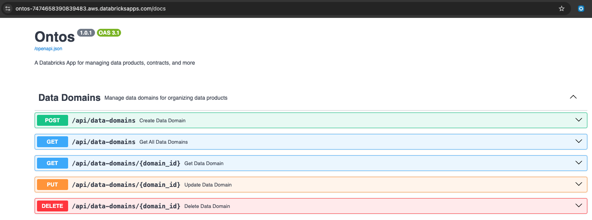
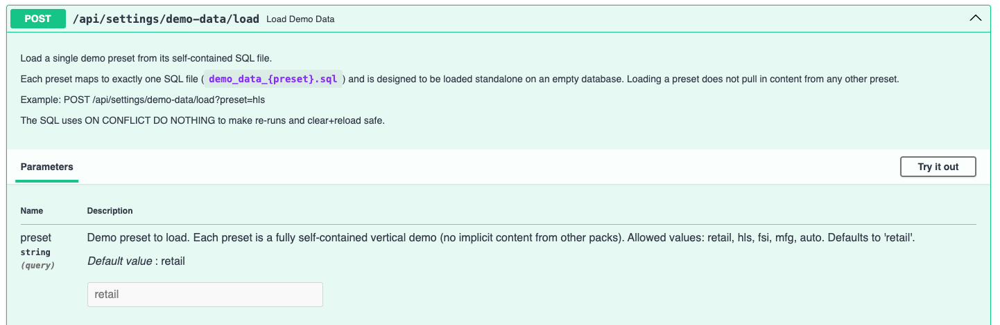
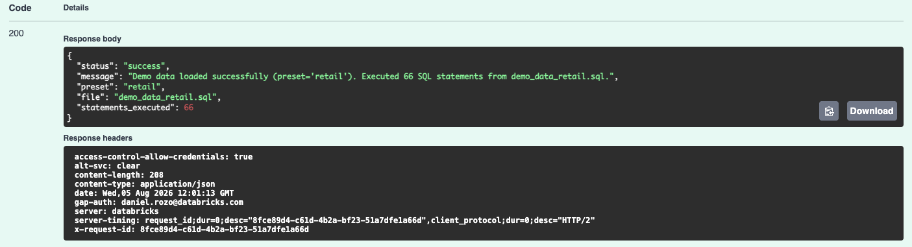
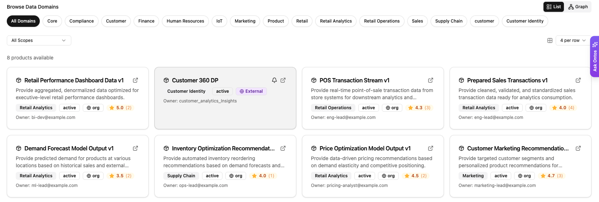
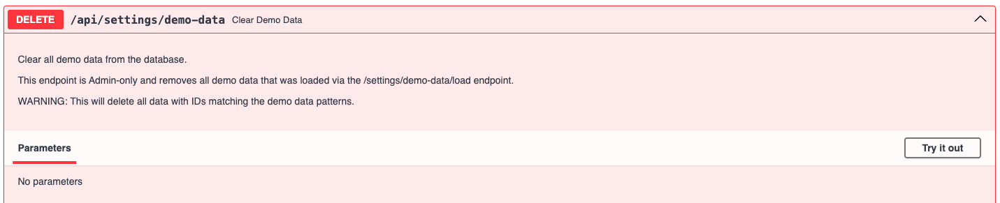
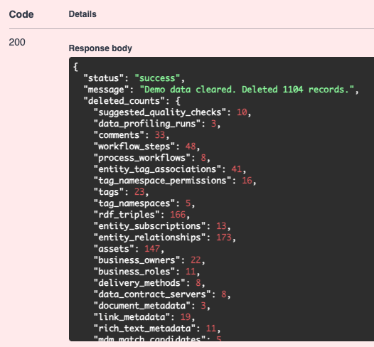

# Demo Setup

Ontos ships with demo data, which can be loaded or removed on demand. To achieve this, follow the instructions below:

:::warning

We suggest avoiding loading demo data on your Ontos production instance and instead using low-priority environments like sandbox or demo setups.

:::

## Load data

To load the demo data, follow these steps:

1. Navigate to the Ontos API documentation page (by editing the URL in the browser's address bar):

```bash
open https://<your-ontos-app-url>/docs
```



2. Locate the *demo-data* POST API endpoint, select *Try it out*, and then *Execute*



3. The API should give you a 200 Successful response



4. Reload the Ontos Marketplace page, and you'll see your demo data loaded.



## Delete data

To remove the demo data, follow these steps:

1. Navigate to the Ontos API documentation page (by editing the URL in the browser's address bar):

```bash
open https://<your-ontos-app-url>/docs
```

2. Locate the *demo-data* DELETE API endpoint, select *Try it out*, and then *Execute*



3. The API should give you a 200 Successful response



To see what would be removed first, set `dry_run` to `true` before *Execute*: the response lists the records that would be deleted per table, and nothing is changed.

Records you created yourself are never deleted or changed by this call, even when they refer to demo data (for example an asset of a demo asset type, or a data product owned by a demo team). If there are any, the call answers 409, lists them per table with their ids, and deletes nothing; delete them or move them off the demo data, then run it again.
